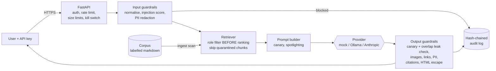

# Architecture

## Request flow
1. **API layer:**
   - API key checked against stored SHA-256 hashes;
   - per-user token-bucket rate limit;
   - 20,000-character hard limit on the body;
   - security headers on every response;
   - kill switch (`GATEWAY_DISABLED`).
2. **Input guardrails:**
   - the question is cut off at 2,000 characters (configurable);
   - text is normalised and scored for injection, and the request is refused at or above 0.5;
   - PII is redacted so it is never sent to the model.
3. **Retrieval:** BM25 over chunks the caller's role may see, excluding chunks quarantined at ingest. Top 3 chunks.
4. **Prompt:**
   - the system prompt contains a fresh random canary for each request;
   - documents are wrapped in `<document>` tags, with any look-alike tags removed;
   - the model is told that text inside the tags is untrusted data.
5. **Model:** a pluggable provider. The default mock is deliberately gullible (ADR-0004).
6. **Output guardrails:**
   - block if the canary or a 60-character run of the system prompt appears;
   - remove images;
   - drop links to hosts that are not on the allow-list;
   - redact PII;
   - remove citations to documents that were not retrieved;
   - escape HTML.
7. **Audit:** one hash-chained JSON line per request. An admin endpoint verifies the chain.

## Roles and labels

| Role | public | internal | engineering | hr-confidential |
|---|---|---|---|---|
| employee | ✓ | ✓ | | |
| engineer | ✓ | ✓ | ✓ | |
| hr | ✓ | ✓ | | ✓ |
| admin | ✓ | ✓ | ✓ | ✓ |

## Deployment
The container runs as non-root with a read-only root filesystem, all capabilities dropped and `no-new-privileges`. Its only writable path is the audit volume. `docker-compose.yml` binds the service to localhost. In production, put it behind an ingress with TLS and replace API keys with Entra ID / OIDC group claims mapped to roles.
